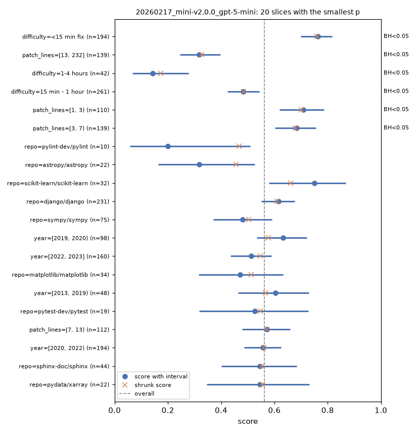

# slicescan

Break per-item evaluation results down by metadata slices, find the slices where a model (or
the gap between two models) differs from the rest, and pay for the fact that many slices were
looked at.

## Why this is hard

Cut a benchmark into enough slices and some of them will look bad by chance alone: twenty
independent tests at 5 % flag at least one false alarm with probability 1 - 0.95^20 = 0.64.
Small slices have intervals so wide that their raw scores mean little, yet they are the ones
that top and bottom a sorted table. Slices of different columns overlap (the same item is in a
repository slice, a difficulty slice and a size slice), and tag columns put one item in several
slices of the same column. And an aggregate can hide or reverse what happens inside the slices:
a system can win overall while losing in most of the slices that make up the total.

## Install

```
pip install git+https://github.com/vipul21435/slicescan
```

Python 3.10 or newer. The library has no dependencies; the `plot` extra
(`pip install "slicescan[plot] @ git+https://github.com/vipul21435/slicescan"`) adds matplotlib
for the optional chart.

## Quickstart

Input is one row per (item, model) with a score, and optionally a metadata file with one row
per item, both JSONL or CSV, joined on the item id. Scores are 0/1 or real numbers. Other
columns of the results file count as item metadata when every model gives an item the same
value; a column that varies by model for the same item (a cost, say) is left out. The example
data is synthetic (`examples/make_example_data.py`), with the system `alpha` planted to do
worse on the project `kiwi`:

```
$ slicescan table examples/data/results.jsonl --meta examples/data/meta.csv --model alpha --kind tags=tag --top 5
## Slices for `alpha`

Overall: 124/240 = 0.517. Interval: wilson; test against the rest: fisher exact.

Family: 14 tests (14 one-way slices of project, lines, tags, each with at least 10 items); adjusted with Holm (family-wise error) and Benjamini-Hochberg (false discovery rate).

Columns:
- `project`: category, 6 slices
- `lines`: numeric, 4 slices
- `tags`: tag, 4 slices; tag column: an item can be in several of its slices, so they overlap

| slice | n | score | 95% CI | shrunk | rest | diff | p | p Holm | p BH |
|---|---|---|---|---|---|---|---|---|---|
| project=kiwi | 40 | 0.200 | [0.105, 0.348] | 0.265 | 0.580 | -0.380 | 1.00e-05 | 1.40e-04 | 1.40e-04 |
| lines=[36, 292] | 62 | 0.419 | [0.305, 0.543] | 0.483 | 0.551 | -0.131 | 0.079 | 1.000 | 0.273 |
| project=apple | 40 | 0.650 | [0.495, 0.779] | 0.623 | 0.490 | +0.160 | 0.083 | 1.000 | 0.273 |
| project=lime | 40 | 0.650 | [0.495, 0.779] | 0.623 | 0.490 | +0.160 | 0.083 | 1.000 | 0.273 |
| lines=[2, 11) | 57 | 0.614 | [0.484, 0.729] | 0.549 | 0.486 | +0.128 | 0.098 | 1.000 | 0.273 |

(9 more rows not shown; all count in the family.)

Slices with p < 0.05: 1 before adjustment, 1 after Benjamini-Hochberg, 1 after Holm.
```

The other commands:

```
slicescan compare   RESULTS --meta META --kind tags=tag A B    # paired difference per slice, McNemar, sign flips
slicescan reversals RESULTS --meta META --kind tags=tag A B    # does the overall winner lose inside the slices?
slicescan explain   RESULTS --meta META --kind tags=tag --model M --slice "project=kiwi"
```

A string cell such as `io|parsing` is split into tags only when the column is named with
`--kind COLUMN=tag`; without it the whole string is one category, the family changes, and so do
the adjusted p-values. JSON list cells are read as tags without the flag.

Common options: `--columns a,b,c`, `--kind COLUMN=category|numeric|tag`, `--bins 4` (quantile
bins for numeric columns), `--tag-sep "|"`, `--min-size 10`, `--two-way` with `--two-way-cap
100`, `--rank COLUMN` (raw and shrunk ranking, `table` only), `--chart out.png` (`table` only),
`--format markdown|json`. `python examples/quickstart.py` runs the same steps from Python.

## How it works

**Slices.** A categorical column gives one slice per value. A numeric column is cut at its
quantiles (linear interpolation, numpy's default rule) into `--bins` bins; ties that make two
edges equal merge those bins and the output says so. A column with no more distinct numbers
than bins is read as categorical. A tag column (a JSON list, or a string split on `--tag-sep`)
gives one slice per tag, so its slices overlap and the output says that too. With `--two-way`,
every intersection of two slices from different columns is a candidate; when there are more
than `--two-way-cap`, the largest are kept. The choice uses slice sizes only, never scores, so
the kept tests still form a family whose adjustment is valid.

**One model (`table`).** Each slice is compared with every other scored item ("the rest").
For 0/1 scores: the Wilson score interval (Wilson 1927) and a two-sided Fisher exact test on
the 2x2 table slice/rest by solved/unsolved. For real-valued scores: a percentile bootstrap
interval of the slice mean and a two-sided permutation test of the difference in means (both
seeded with `--seed`, `--resamples` draws). Slices under `--min-size` items and slices holding
every item are not tested and do not enter the family.

**Multiple testing.** Adjusted p-values over every slice tested, one-way and two-way
together, by Holm's step-down procedure (Holm 1979), which controls the family-wise error rate
under any dependence, and by the Benjamini-Hochberg step-up procedure (Benjamini and Hochberg
1995), which controls the false discovery rate for independent tests and, as later work
showed, for positively dependent ones.
Slices of the same data overlap, so their tests are dependent; Holm needs no assumption about
that, and BH is the less conservative of the two. The output states the family: how many
tests, over which columns, and how many slices were left out and why.

**Shrinkage.** For 0/1 scores, the slices of each column share a Beta(a, b) prior on their
true rates, fitted by the method of moments, and each slice's raw rate `k/n` is replaced by its
posterior mean `(k + a) / (n + a + b)` = `w k/n + (1 - w) mu` with `w = n / (n + a + b)`. Small
slices are pulled hardest toward the column mean `mu`. The prior's mean is the pooled rate; its
size `a + b = 1/rho - 1` comes from matching the weighted spread of the raw rates,
`S = sum n_i (p_i - mu)^2`, to its expectation `mu (1 - mu) [(m - 1) + rho (N - m + 1 - sum
n_i^2 / N)]` under the beta-binomial model (`m` slices, `N` items). When the raw rates spread
no more than binomial noise would make them, every slice is shrunk to `mu`. This is the
beta-binomial form of the empirical-Bayes estimate that Efron and Morris (1975) illustrate on
batting averages. `--rank COLUMN` prints the raw and shrunk rankings side by side; every slice
of the column takes part, including those too small to test.

**Two models (`compare`).** On the items both systems were scored on, each slice's paired
difference A - B. For 0/1 scores: the interval of Agresti and Min (2005) (add one half to each
cell of the paired 2x2 table, then Wald) and the exact McNemar test (McNemar 1947), a binomial
test of the discordant items against one half. For real scores: a normal interval of the mean
difference and a sign-flip permutation test. A slice "flips" when its difference is non-zero
and of the opposite sign to the overall difference; flips are listed whether or not they are
significant, beside their adjusted p-values. Holm and BH run over all slices tested.

**Reversals (`reversals`).** For each column that partitions the items (categorical or
numeric; tag columns are skipped, and items with no value form a `(missing)` slice), each
system is scored on its own items overall and inside each slice. The verdict is `full` when
the overall winner loses in every slice that is not tied (at least two), `majority` when it
loses in more than half of the slices, and `none` otherwise. This is the pattern Simpson (1951)
described and Bickel, Hammel and O'Connell (1975) found in graduate admissions. When both
systems were scored on exactly the same items, the overall difference is the size-weighted
mean of the slice differences, so a full reversal is arithmetically impossible; only a
majority reversal can happen, and the output notes this. A full reversal needs the systems to
have been run on different items, as in the kidney-stone example that the tests rebuild.

**One slice (`explain`).** The slice's 2x2 table, interval, test, shrunk score, its rank and
adjusted p-values inside the same family `table` builds with the same options (or a plain
statement that it was not in the family, so its raw p-value has not paid for the other slices),
the slice broken down by every other column, and the first items it failed.

## Results on SWE-bench Verified

Data: per-instance results of six public SWE-bench Verified submissions from the
[SWE-bench/experiments](https://github.com/SWE-bench/experiments) repository (read at commit
`40f164d5`; all six are folders named `20260217_mini-v2.0.0_*`), and instance metadata from the
[SWE-bench Verified dataset card](https://huggingface.co/datasets/princeton-nlp/SWE-bench_Verified)
(500 instances; the benchmark is from Jimenez et al. 2024). Neither page states a licence, so
nothing from either is committed here: `examples/swebench_verified/fetch.py` downloads them and
derives the metadata columns `repo` (12 repositories), `difficulty` (the dataset's four
annotation classes), `year` (year the issue was created, cut into quartile bins) and
`patch_lines` (added plus removed lines in the reference patch, quartile bins). It also writes
`f2p_tests` (the number of FAIL_TO_PASS tests), which the numbers below do not use; run the
commands with `--columns` as shown, since leaving it out adds that column to the family. Submissions
are named below by their folder names with the common prefix `20260217_mini-v2.0.0_` dropped.

```
python examples/swebench_verified/fetch.py DATA
python examples/swebench_verified/summarise.py DATA
```

**Slices that differ from the rest, before and after adjustment.** 20 one-way slices tested
per submission (minimum 10 items; 4 smaller slices left out). `repo ranks moved` counts
repositories whose shrunk rank differs from their raw rank (tied raw rates share the average
of their ranks), and Spearman is the rank correlation between raw and shrunk rates:

| submission | solved | tests | p<0.05 raw | BH | Holm | repo ranks moved | Spearman |
|---|---|---|---|---|---|---|---|
| claude-4-5-haiku-high | 333/500 | 20 | 7 | 6 | 6 | 10 of 12 | 0.873 |
| deepseek-3-2-high | 350/500 | 20 | 8 | 8 | 4 | 9 of 12 | 0.865 |
| gemini-3-flash-high | 379/500 | 20 | 8 | 5 | 4 | 7 of 12 | 0.883 |
| glm-5-high | 364/500 | 20 | 8 | 8 | 6 | 8 of 12 | 0.907 |
| gpt-5-mini | 281/500 | 20 | 10 | 6 | 6 | 12 of 12 | 0.888 |
| kimi-k2-5-high | 354/500 | 20 | 8 | 7 | 6 | 8 of 12 | 0.858 |

What survives adjustment is mostly difficulty and patch size. In all six submissions the
slices with a BH-adjusted p below 0.05 include `difficulty=<15 min fix`, `difficulty=1-4 hours`
and three of the four patch-size quarters; repository slices survive BH in four of the six
(`repo=pylint-dev/pylint` in each of those four). For `gpt-5-mini`,
`difficulty=<15 min fix` solves 0.763 against 0.435 for the rest (Holm p 6.3e-12),
`difficulty=1-4 hours` 0.143 against 0.600, and the largest quarter of reference patches (13
to 232 changed lines) 0.317 against 0.657. The repository slices below the rest with raw p
under 0.05 do not survive adjustment: `repo=pylint-dev/pylint` (2 of 10 solved, raw p 0.025) and
`repo=astropy/astropy` (7 of 22, raw p 0.026) both end at Holm p 0.346 and BH p
0.060. `slicescan explain ... --slice "repo=pylint-dev/pylint"` breaks that slice down: 5 of its 10 instances are in the largest
patch-size quarter, and none of those 5 was solved.

```
slicescan table DATA/results.jsonl --meta DATA/meta.csv --model 20260217_mini-v2.0.0_gpt-5-mini \
    --columns repo,difficulty,year,patch_lines --rank repo
```

The same table as a chart (`--top 20 --chart docs/gpt-5-mini-slices.png`): dots are raw scores
with their Wilson intervals, crosses the shrunk scores, the dashed line the overall score, and
the slices marked on the right have a BH-adjusted p below 0.05.



**Shrunk against raw ranking of repositories.** For `gpt-5-mini` the fitted prior has mean
0.562 and size a + b = 28.6 items. The raw ranking puts `pallets/flask` first (1 instance,
solved), with `psf/requests` (6 of 8) and `scikit-learn/scikit-learn` (24 of 32) tied second
at 0.750 (rank 2.5 each); shrunk, `pallets/flask` falls to 4th, `psf/requests` to 3rd, and
`scikit-learn/scikit-learn` rises to 1st. At the bottom,
`pylint-dev/pylint` (raw 0.200) is pulled to 0.468 and `astropy/astropy` (raw 0.318) to 0.456.
For `gemini-3-flash-high`, `mwaskom/seaborn` (0 of 2) is last on raw score and 10th of 12
shrunk.

**Pairs and reversals.** Over all 15 pairs (the second table `summarise.py` prints), the paired
overall differences run in absolute size from 0.008 (`deepseek-3-2-high` minus
`kimi-k2-5-high`, -0.008) to 0.196 (`gemini-3-flash-high` minus `gpt-5-mini`, +0.196); signed,
they run from -0.146 (`gpt-5-mini` minus `kimi-k2-5-high`) to +0.196. The number of slices
whose difference has the opposite sign to the overall one runs from 0 (three pairs, each
against `gpt-5-mini`) to 8 (`deepseek-3-2-high` against `kimi-k2-5-high`, the closest pair); none of these flips has a BH-adjusted p below 0.05. No pair shows a reversal on
`repo`, `difficulty`, `year` or `patch_lines`, full or majority. All six submissions were
scored on the same 500 instances, so a full reversal was impossible to begin with.

```
slicescan compare DATA/results.jsonl --meta DATA/meta.csv \
    20260217_mini-v2.0.0_deepseek-3-2-high 20260217_mini-v2.0.0_kimi-k2-5-high \
    --columns repo,difficulty,year,patch_lines
slicescan reversals DATA/results.jsonl --meta DATA/meta.csv \
    20260217_mini-v2.0.0_deepseek-3-2-high 20260217_mini-v2.0.0_kimi-k2-5-high \
    --columns repo,difficulty,year,patch_lines
```

## Tests

`pytest` runs offline and builds its own fixtures. It checks Fisher, binomial and McNemar
p-values against scipy and statsmodels, Holm and BH against statsmodels' `multipletests`, the
Wilson interval against statsmodels, the bootstrap and permutation tests against scipy within
Monte Carlo error, the Agresti-Min interval's coverage by simulation, the shrinkage estimate on
a hand-worked case and on simulated beta-binomial data, the false-discovery rate under a global
null by seeded simulation (150 datasets of 300 items and 14 slices: BH and Holm must flag
something in at most 8 % of them, unadjusted tests in more than 20 %), a planted bad slice, a
planted sign flip and the kidney-stone reversal.

## Limitations

- Shrinkage is for 0/1 scores only; real-valued scores get raw means.
- The shrinkage prior is fitted by the method of moments, not by maximum marginal likelihood,
  and the posterior is reported as a mean (and a standard deviation in the API), not an
  interval.
- Fisher's test is conditional and conservative for small slices, so both adjustments are on
  the cautious side.
- BH has no formal guarantee for these tests. Its proofs need independent or positively
  dependent tests, and the slices of one column, each tested against the rest, are negatively
  correlated. The evidence offered here is the seeded global-null simulation in the tests
  (described above), not a proof.
- With two or three slices the moment estimate of the prior often reaches its upper limit and
  nothing is shrunk. For a tag column the pooled rate counts an item once per tag it carries.
- The test of a slice against "the rest" depends on what else is in the data: one very bad
  slice drags the rest down and can make healthy slices look better than the rest.
- The reversal check counts slices; it does not test whether the reversed slice differences
  are themselves significant (`compare` gives those p-values).
- Two-way slices are the only interactions; there is no search over deeper slices and no slice
  discovery from embeddings or model errors.
- The real-data run covers six submissions from one scaffold version; nothing here says how
  other submissions behave.

## Related tools

- [evalstats](https://github.com/vipul21435/evalstats): error bars and paired comparisons for
  the whole benchmark; slicescan works inside its slices.
- [irtbench](https://github.com/vipul21435/irtbench): models the items themselves.
- [evaltable](https://github.com/vipul21435/evaltable): builds the per-item results table that
  slicescan reads.
- Chung, Kraska, Polyzotis, Tae and Whang, "Automated Data Slicing for Model Validation: A Big
  data - AI Integration Approach", arXiv:1807.06068, 2018.
- Eyuboglu, Varma, Saab, Delbrouck, Lee-Messer, Dunnmon, Zou and Ré, "Domino: Discovering
  Systematic Errors with Cross-Modal Embeddings", ICLR 2022, arXiv:2203.14960.
- Ribeiro, Wu, Guestrin and Singh, "Beyond Accuracy: Behavioral Testing of NLP Models with
  CheckList", ACL 2020, pp. 4902-4912.

## References

- Y. Benjamini and Y. Hochberg. Controlling the False Discovery Rate: A Practical and Powerful
  Approach to Multiple Testing. Journal of the Royal Statistical Society, Series B 57(1),
  289-300, 1995.
- S. Holm. A Simple Sequentially Rejective Multiple Test Procedure. Scandinavian Journal of
  Statistics 6, 65-70, 1979.
- E. B. Wilson. Probable Inference, the Law of Succession, and Statistical Inference. Journal
  of the American Statistical Association 22(158), 209-212, 1927.
- Q. McNemar. Note on the Sampling Error of the Difference Between Correlated Proportions or
  Percentages. Psychometrika 12(2), 153-157, 1947.
- A. Agresti and Y. Min. Simple improved confidence intervals for comparing matched
  proportions. Statistics in Medicine 24(5), 729-740, 2005.
- B. Efron and C. Morris. Data Analysis Using Stein's Estimator and its Generalizations.
  Journal of the American Statistical Association 70(350), 311-319, 1975.
- E. H. Simpson. The Interpretation of Interaction in Contingency Tables. Journal of the Royal
  Statistical Society, Series B 13(2), 238-241, 1951.
- P. J. Bickel, E. A. Hammel and J. W. O'Connell. Sex Bias in Graduate Admissions: Data from
  Berkeley. Science 187(4175), 398-404, 1975.
- C. E. Jimenez, J. Yang, A. Wettig, S. Yao, K. Pei, O. Press and K. Narasimhan. SWE-bench:
  Can Language Models Resolve Real-World GitHub Issues? ICLR 2024, arXiv:2310.06770.

## Licence

MIT. See `LICENSE`.

Built by Vipul Raj Jha · https://vipul21435.github.io
